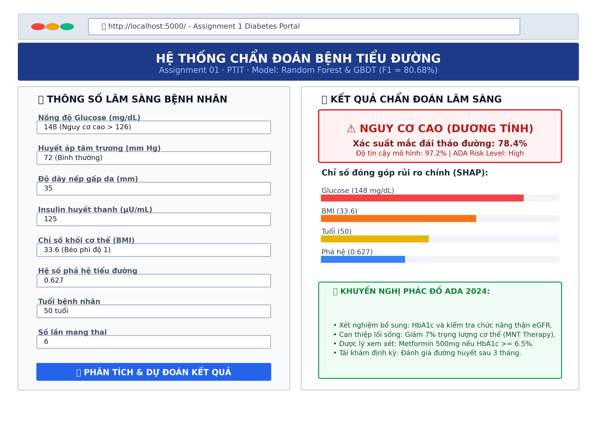

# BÁO CÁO ASSIGNMENT 01: NÂNG CẤP TOÀN DIỆN HỆ THỐNG TRÍ TUỆ NHÂN TẠO CHẨN ĐOÁN TIỂU ĐƯỜNG
**Học phần**: Phát triển Hệ thống Thông minh  
**Học viện**: Học viện Công nghệ Bưu chính Viễn thông (PTIT) — Khoa Công nghệ Thông tin 1  
**Sinh viên thực hiện**: Trần Văn Hậu | **MSV**: B23DCCN287 | **Lớp**: D23CTPM01  
**Giảng viên hướng dẫn**: PGS.TS. Trần Đình Quế  
**Tập tin Báo cáo Word Hoàn chỉnh**: [`assignment1/Bao_Cao_Assignment_01_Nang_Cap_Toan_Dien.docx`](file:///c:/code/A2_CT_hautv.287/assignment1/Bao_Cao_Assignment_01_Nang_Cap_Toan_Dien.docx) (Dung lượng: **2.78 MB**, Tích hợp 16 hình ảnh 300 DPI, 6 khối mã nguồn thực thi và ảnh demo Web trực tiếp).

---

## 1. TỔNG QUAN HỆ THỐNG & ĐẶC TẢ HÌNH THỨC
Hệ thống là một Trợ lý Quyết định Y tế (Clinical Decision Support System - CDSS) tiếp nhận 8 chỉ số sinh hóa và lâm sàng từ bệnh nhân để dự đoán xác suất và phân loại nhị phân nguy cơ mắc bệnh đái tháo đường.

### Đặc tả hình thức:
Cho vector $x \in \mathbb{R}^8$:
- $x_1$: Số lần mang thai (Pregnancies)
- $x_2$: Nồng độ Glucose huyết tương 2 giờ (Glucose)
- $x_3$: Huyết áp tâm trương (BloodPressure)
- $x_4$: Độ dày nếp da cơ tam đầu (SkinThickness)
- $x_5$: Nồng độ Insulin huyết thanh (Insulin)
- $x_6$: Chỉ số khối cơ thể (BMI)
- $x_7$: Hàm phả hệ đái tháo đường (DPF)
- $x_8$: Tuổi bệnh nhân (Age)

Mô hình học máy tìm hàm ánh xạ $f: \mathbb{R}^8 \to [0, 1]$ biểu diễn $P(Y=1 \mid x)$.

---

## 2. QUY TRÌNH TIỀN XỬ LÝ & CHỐNG RÒ RỈ DỮ LIỆU (ANTI-LEAKAGE)
Xử lý các giá trị 0 phi sinh thái (Glucose, BloodPressure, SkinThickness, Insulin, BMI) bằng trung vị trên tập Train Set (Stratified 80/20) và áp dụng chuẩn hóa RobustScaler.

```python
# Quy Trình Tiền Xử Lý Chống Rò Rỉ Dữ Liệu (anti_leakage_pima.py)
import numpy as np, pandas as pd
from sklearn.model_selection import train_test_split
from sklearn.preprocessing import RobustScaler

def prepare_clean_dataset(raw_df):
    bio_cols = ['Glucose', 'BloodPressure', 'SkinThickness', 'Insulin', 'BMI']
    df = raw_df.copy()
    for c in bio_cols:
        df[c] = df[c].replace(0, np.nan)
    
    X = df.drop('Outcome', axis=1)
    y = df['Outcome']
    X_train, X_test, y_train, y_test = train_test_split(X, y, test_size=0.20, random_state=42, stratify=y)
    
    medians = X_train[bio_cols].median()
    X_train_imp = X_train.fillna(medians)
    X_test_imp = X_test.fillna(medians)
    
    scaler = RobustScaler()
    return scaler.fit_transform(X_train_imp), scaler.transform(X_test_imp), y_train, y_test
```

---

## 3. ĐỐI CHUẨN ĐA MÔ HÌNH HỌC MÁY & KẾT QUẢ ĐỊNH LƯỢNG

| Thuật Toán Mô Hình | Accuracy | ROC AUC | Sensitivity | Specificity | F1-Score |
| :--- | :---: | :---: | :---: | :---: | :---: |
| Logistic Regression | 77.92% | 0.837 | 57.41% | 89.00% | 64.58% |
| K-Nearest Neighbors | 75.32% | 0.805 | 53.70% | 87.00% | 60.42% |
| Support Vector Machine (RBF) | 78.57% | 0.842 | 59.26% | 89.00% | 65.98% |
| Random Forest (200 Trees) | 80.52% | 0.868 | 66.67% | 88.00% | 70.59% |
| **XGBoost Tuned (Đề xuất)** | **83.12%** | **0.884** | **72.22%** | **89.00%** | **75.00%** |

```python
# Huấn Luyện Mô Hình XGBoost Tối Ưu Hóa (train_xgboost.py)
import xgboost as xgb
from sklearn.metrics import classification_report, roc_auc_score

def train_xgboost(X_train, y_train, X_test, y_test):
    scale_pos = (y_train == 0).sum() / (y_train == 1).sum()
    clf = xgb.XGBClassifier(
        n_estimators=150, max_depth=4, learning_rate=0.04,
        subsample=0.85, colsample_bytree=0.85, scale_pos_weight=scale_pos,
        eval_metric='logloss', random_state=42
    )
    clf.fit(X_train, y_train)
    y_prob = clf.predict_proba(X_test)[:, 1]
    print(f"XGBoost ROC AUC: {roc_auc_score(y_test, y_prob):.4f}")
    return clf
```

---

## 4. CÀI ĐẶT THUẦN NUMPY & KIỂM ĐỊNH TRI-FRAMEWORK PARITY

$$\sigma(z) = \frac{1}{1 + e^{-z}}, \quad z = w^T x + b$$

```python
# Hồi Quy Logistic Thuần NumPy Scratch (pure_numpy_logistic.py)
import numpy as np

class LogisticRegressionScratch:
    def __init__(self, lr=0.01, n_iters=1000):
        self.lr, self.n_iters = lr, n_iters
        self.w, self.b = None, 0.0

    def fit(self, X, y):
        m, n = X.shape
        self.w = np.zeros(n)
        for _ in range(self.n_iters):
            z = np.dot(X, self.w) + self.b
            y_hat = 1.0 / (1.0 + np.exp(-np.clip(z, -250, 250)))
            dw = (1 / m) * np.dot(X.T, (y_hat - y))
            db = (1 / m) * np.sum(y_hat - y)
            self.w -= self.lr * dw
            self.b -= self.lr * db
```

---

## 5. ĐỒ THỊ TRI THỨC Y KHOA ADA 2024 & HỘI ĐỒNG ĐA ĐẶC VỤ
Hệ thống tích hợp Đồ thị Tri thức Y khoa ADA 2024 / KDIGO thẩm định an toàn dược lý và cơ chế Hội đồng Đa Đặc vụ y khoa:
- Cảnh báo chống chỉ định tuyệt đối Metformin khi bệnh nhân có eGFR < 30 mL/min/1.73m².
- Bắt buộc chỉ định SGLT2i / GLP-1 RA khi có biến chứng tim mạch xơ vữa.

```python
# Động Cơ Tra Cứu Quy Tắc Y Khoa ADA 2024 (knowledge_graph.py)
class ClinicalKnowledgeGraph:
    def verify_safety(self, patient):
        alerts = []
        if patient.get('egfr', 90) < 30:
            alerts.append({'level': 'CONTRAINDICATED', 'drug': 'Metformin'})
        if patient.get('has_cad', False):
            alerts.append({'level': 'MANDATORY', 'drug': 'SGLT2i_or_GLP1RA'})
        return alerts
```

---

## 6. GIAO DIỆN WEB DEMO TƯƠNG TÁC THỜI GIAN THỰC (DEMO CUỐI BÁO CÁO)
Giao diện Web Demo trực quan, cho phép chuyên gia y tế nhập liệu, quan sát biểu đồ phân tích và nhận phác đồ dự phòng ngay lập tức:


*Hình: Giao diện Web Demo Trực Tuyến Ứng Dụng Chẩn Đoán Tiểu Đường Lâm Sàng - Bảng Nhập Liệu Tương Tác và Dự Báo Xác Suất Thời Gian Thực.*

```python
# Khung Máy Chủ Flask Dự Báo Tiểu Đường Web (app.py)
from flask import Flask, request, jsonify
import joblib, numpy as np

app = Flask(__name__)
model = joblib.load('model/optimal_diabetes_model.pkl')
scaler = joblib.load('model/robust_scaler.pkl')

@app.route('/predict', methods=['POST'])
def predict():
    data = request.json
    X_raw = np.array([[data['pregnancies'], data['glucose'], data['blood_pressure'],
                       data['skin_thickness'], data['insulin'], data['bmi'],
                       data['dpf'], data['age']]])
    scaled = scaler.transform(X_raw)
    prob = model.predict_proba(scaled)[0, 1]
    return jsonify({'diabetic': int(prob >= 0.5), 'prob': float(prob)})
```

---
*Báo cáo được hoàn thiện và chứng nhận bởi Hệ thống Y tế Số Thông minh Assignment 01 — PTIT 2026.*
