# BÁO CÁO TIỂU LUẬN MÔN HỌC
## PHÁT TRIỂN HỆ THỐNG THÔNG MINH
**ĐỀ TÀI:**
# TRÍ TUỆ NHÂN TẠO TRONG ĐẦU TƯ TÀI CHÍNH & QUẢN TRỊ RỦI RO: TỪ HỌC MÁY CƠ BẢN ĐẾN MẠNG NƠ-RON TÍCH CHẬP VÀ MẠNG NƠ-RON HỒI QUY
*(Phần 1: Mở đầu – Chương 4)*

---

### THÔNG TIN CHUNG
- **Học viện**: Học viện Công nghệ Bưu chính Viễn thông (PTIT) — Khoa Công nghệ Thông tin 1
- **Giảng viên hướng dẫn**: **PGS. TS. Trần Đình Quế**
- **Sinh viên thực hiện**: **Trần Văn Hậu**
- **Mã sinh viên**: **B23DCCN287**
- **Lớp**: **D23CQCN01-B** (Nhóm lớp: **CT01**)
- **Nhóm tiểu luận**: **Nhóm 09** (CT_09)
- **Tập tin Báo cáo Word đính kèm**: [`tieuluan01_CT01_09_TranVanHau.docx`](file:///c:/code/A2_CT_hautv.287/tieuluan1/tieuluan01_CT01_09_TranVanHau.docx)
- **Kho mã nguồn & Thực nghiệm**: Thư mục `tieuluan1/src/`, `tieuluan1/charts/`, `tieuluan1/web/`
- **Hà Nội, tháng 11 năm 2026**

---

## TÓM TẮT TIỂU LUẬN (ABSTRACT)
Tiểu luận này nghiên cứu và hiện thực hóa một hệ thống học máy định lượng và học sâu toàn diện ứng dụng trong bài toán dự báo chuỗi thời gian tài chính và thẩm định rủi ro tín dụng. Nghiên cứu bám sát yêu cầu môn học Phát triển Hệ thống Thông minh, triển khai đồng bộ từ nền tảng lịch sử AI (Chương 1), các kỹ thuật Học máy cơ bản trên dữ liệu bảng rủi ro (Chương 2), Mạng nơ-ron Tích chập (CNN) trên biểu diễn không gian 2D Gramian Angular Summation Field (Chương 3), đến Mạng nơ-ron Hồi quy (RNN/LSTM/GRU) và cơ chế Chú ý Thời gian (Temporal Attention) trên chuỗi lợi suất logarit (Chương 4).

Toàn bộ hệ thống thực nghiệm được xây dựng theo chuẩn **Tri-Framework**: Tự cài đặt từ đầu bằng Python/NumPy (vector hóa thuần túy qua thuật toán `im2col` và lan truyền ngược theo thời gian BPTT), đối chiếu đồng bộ trọng số khởi tạo và thứ tự batch với **PyTorch** và **Keras 3**. Kết quả kiểm thử đạo hàm số trị đạt sai số tương đối $\le 6.26 \times 10^{-9}$ và độ lệch dự báo giữa 3 nền tảng đạt mức dung sai số thực $\le 2.38 \times 10^{-7}$. 

Tiểu luận nâng cấp mở rộng khảo sát 4 thị trường tài sản: **S&P 500** (thị trường phát triển), **VN-Index** (thị trường Việt Nam qua dữ liệu làm sạch SSI/DNSE), **Bitcoin** (Crypto Tier 1) và **Ethereum** (Smart Contract Platform); bổ sung mô hình Gradient Boosting (**LightGBM**), Khối phần dư (**Residual Block**), Mạng hồi quy hai chiều (**Bi-LSTM**) và **Cơ chế Chú ý (Attention)**. Đồng thời, nghiên cứu xây dựng công cụ kiểm thử giao dịch định lượng (**Backtesting Engine**) phản ánh ma sát chi phí giao dịch và thuế thực tế, đo lường các chỉ số Sharpe, Sortino, Calmar và Sụt giảm tối đa (Max Drawdown), cung cấp góc nhìn khoa học khách quan về Giả thuyết Thị trường Hiệu quả (EMH).

---

## MỤC LỤC
1. **MỞ ĐẦU**
   - 1.1. Lý do chọn đề tài
   - 1.2. Mục tiêu nghiên cứu
   - 1.3. Câu hỏi nghiên cứu (Research Questions)
   - 1.4. Đối tượng và phạm vi nghiên cứu
   - 1.5. Phương pháp nghiên cứu
   - 1.6. Những đóng góp và nâng cấp chính của tiểu luận
   - 1.7. Bố cục tiểu luận
2. **CHƯƠNG 1. LỊCH SỬ PHÁT TRIỂN CỦA TRÍ TUỆ NHÂN TẠO & KINH LƯỢNG HỌC TÀI CHÍNH**
   - 1.1. Trí tuệ nhân tạo là gì? Sự chuyển dịch các mô thức
   - 1.2. Giai đoạn hình thành và lạc quan ban đầu (1943–1969)
   - 1.3. Hệ chuyên gia dựa trên tri thức và hai mùa đông AI (1969–1993)
   - 1.4. Học máy thống kê và sự trỗi dậy của mạng nơ-ron (1986–2011)
   - 1.5. Kỷ nguyên học sâu bùng nổ (2012–2021)
   - 1.6. Kỷ nguyên AI tạo sinh và mô hình nền tảng chuỗi thời gian (2022–2026)
   - 1.7. Lịch sử song hành của AI trong định lượng tài chính và đầu tư
   - 1.8. Dữ liệu minh họa: 4 chuỗi chỉ số thị trường
   - 1.9. Phân tích kinh lượng học: Tính dừng (ADF/KPSS), Đuôi béo (Leptokurtic) và ARCH Effect
   - 1.10. Tiểu kết chương 1
3. **CHƯƠNG 2. CÁC KỸ THUẬT HỌC MÁY CƠ BẢN TRÊN DỮ LIỆU BẢNG**
   - 2.1. Bản chất của học máy và quy trình xây dựng mô hình định lượng
   - 2.2. Hồi quy tuyến tính, hàm mất mát sai số bình phương và hạ gradient
   - 2.3. Hồi quy Logistic cho xác suất rủi ro: Dẫn xuất Maximum Likelihood & BCE
   - 2.4. Cây quyết định và phương pháp tổ hợp: Bagging (Random Forest) vs Boosting (LightGBM/XGBoost)
   - 2.5. Mạng nơ-ron nhiều lớp (MLP) và dẫn xuất lan truyền ngược qua ma trận Jacobian
   - 2.6. Thuật toán tối ưu hóa thích nghi Adam và cắt chuẩn gradient
   - 2.7. Đánh giá mô hình trên dữ liệu mất cân bằng (ROC-AUC, AP, Balanced Accuracy)
   - 2.8. Dữ liệu thực nghiệm: 2 bộ dữ liệu bảng chuẩn UCI (Phá sản & Vỡ nợ tín dụng)
   - 2.9. Cài đặt đối kháng Tri-Framework: NumPy tự viết, PyTorch và Keras
   - 2.10. Kết quả thực nghiệm và thảo luận chuyên sâu
   - 2.11. Xu hướng mới: Tabular Foundation Models (TabPFN, FT-Transformer)
   - 2.12. Tiểu kết chương 2
4. **CHƯƠNG 3. MẠNG NƠ-RON TÍCH CHẬP (CNN) & THỊ GIÁC HÓA CHUỖI THỜI GIAN**
   - 3.1. Vì sao cần mạng tích chập? Tiên đề bất biến tịnh tiến và tính cục bộ
   - 3.2. Toán học của phép tích chập 2D và phép tương quan chéo
   - 3.3. Bộ lọc, bước trượt, phần đệm và vùng tiếp nhận hiệu dụng (Receptive Field)
   - 3.4. Hàm kích hoạt phi tuyến, Max Pooling và tối ưu phần cứng bằng thuật toán im2col
   - 3.5. Các kiến trúc CNN kinh điển và Khối phần dư Residual Block (Nâng cấp)
   - 3.6. Ứng dụng CNN trong tài chính: Bài học từ bài báo "(Re-)Imag(in)ing Price Trends"
   - 3.7. Kỹ thuật chuyển đổi chuỗi 1D sang ảnh 2D: GASF, GADF và MTF
   - 3.8. Cài đặt Tri-Framework: NumPy scratch im2col, PyTorch và Keras
   - 3.9. Kết quả thực nghiệm trên 4 thị trường và kiểm định Block Bootstrap 95%
   - 3.10. Trực quan hóa đặc trưng bộ lọc (Feature Map Activations)
   - 3.11. Thảo luận khoa học: Bản chất tín hiệu hướng đi ngắn hạn và giả thuyết EMH
   - 3.12. Tiểu kết chương 3
5. **CHƯƠNG 4. MẠNG NƠ-RON HỒI QUY (RNN) & DỰ BÁO CHUỖI THỜI GIAN**
   - 4.1. Bản chất dữ liệu chuỗi tài chính và tính phụ thuộc thời gian
   - 4.2. Mạng hồi quy đơn giản (SimpleRNN) và lan truyền ngược theo thời gian (BPTT)
   - 4.3. Dẫn xuất toán học vấn đề tiêu biến/bùng nổ gradient trong chuỗi dài
   - 4.4. Mạng LSTM: Cấu trúc 3 cổng và "Đường cao tốc thông tin" (Gradient Highway)
   - 4.5. Mạng GRU: Phiên bản tinh gọn tham số
   - 4.6. NÂNG CẤP KIẾN TRÚC: Bidirectional LSTM và Cơ chế Chú ý Thời gian (Temporal Attention)
   - 4.7. Chuẩn bị chuỗi 20 lợi suất logarit chuẩn hóa không nhìn tương lai (Anti-leakage)
   - 4.8. Cài đặt Tri-Framework: NumPy tự viết BPTT, PyTorch và Keras
   - 4.9. Kết quả thực nghiệm và so sánh độ ổn định kiến trúc
   - 4.10. Từ dự báo đến chiến lược đầu tư: Công cụ Backtesting định lượng trừ phí thực tế
   - 4.11. Đánh giá đa chiều: Lợi suất năm, Biến động, Sharpe, Sortino, Calmar và Sụt giảm tối đa
   - 4.12. Xu hướng mới: State Space Models (Mamba), xLSTM và Time-Series Foundation Models
   - 4.13. Tiểu kết chương 4
6. **KẾT LUẬN & ĐỊNH HƯỚNG MỞ RỘNG**
   - 6.1. Trả lời các câu hỏi nghiên cứu
   - 6.2. Bài học kinh nghiệm khoa học và kỹ thuật
   - 6.3. Giới hạn nghiên cứu
   - 6.4. Định hướng mở rộng cho Phần 2 (Chương 5: Knowledge Graph/RAG, Chương 6: Deep Graph, Chương 7: Hệ đa Agent)
7. **TÀI LIỆU THAM KHẢO**

---

## MỞ ĐẦU

### 1. Lý do chọn đề tài
Trong kỷ nguyên số hóa của thị trường vốn toàn cầu, Trí tuệ Nhân tạo (Artificial Intelligence - AI) đã trở thành công cụ cốt lõi trong phân tích định lượng (Quantitative Finance), quản trị rủi ro hệ thống và tự động hóa giao dịch thuật toán. Tuy nhiên, việc áp dụng các mô hình học máy và học sâu vào dữ liệu tài chính đặt ra những thách thức khoa học vô cùng đặc thù:
- **Tỉ số Tín hiệu trên Nhiễu cực thấp (Signal-to-Noise Ratio - SNR)**: Lợi suất giá tài sản trên các thị trường tài chính phản ánh kỳ vọng của hàng triệu tác nhân kinh tế, chịu ảnh hưởng bởi tâm lý bầy đàn, biến động vĩ mô và bất cân xứng thông tin.
- **Tính phi dừng (Non-stationarity) và Đuôi béo (Fat-tailed / Leptokurtic Distributions)**: Phân phối lợi suất thực tế vi phạm nghiêm trọng giả định phân phối chuẩn Gauss của tài chính cổ điển, thường xuyên xuất hiện các sự kiện thiên nga đen (Black Swan events).
- **Rủi ro rò rỉ dữ liệu tương lai (Look-ahead Bias / Data Leakage)**: Việc tiền xử lý dữ liệu sai phương pháp hoặc chia tập Train/Val/Test ngẫu nhiên thay vì theo thời gian sẽ tạo ra kết quả ảo tưởng về độ chính xác, nhưng dẫn đến thua lỗ nặng nề trong thực tế.
- **Rào cản ma sát chi phí giao dịch (Transaction Costs & Taxes)**: Một mô hình có độ chính xác dự báo hướng đi vượt trội trên lý thuyết có thể hoàn toàn mất khả năng sinh lời khi phải trả phí môi giới, phí sàn và thuế chuyển nhượng tài sản.

Xuất phát từ yêu cầu đào tạo chuyên sâu của học phần **Phát triển Hệ thống Thông minh** tại Học viện Công nghệ Bưu chính Viễn thông do PGS.TS. Trần Đình Quế phụ trách, tiểu luận này lựa chọn đề tài: *"Trí tuệ nhân tạo trong đầu tư tài chính: Từ học máy cơ bản đến mạng tích chập và mạng hồi quy"*. Đề tài giúp sinh viên nắm vững bản chất toán học từ các thuật toán sơ khai, tự tay hiện thực hóa mã nguồn từ mức tensor cơ bản đến các thư viện công nghiệp hiện đại, đồng thời kiểm nghiệm khách quan trên dữ liệu thực tế của các thị trường tài chính lớn.

### 2. Mục tiêu nghiên cứu
1. **Hệ thống hóa toàn diện lịch sử phát triển của AI**: Phân tích sự chuyển dịch mô thức từ AI dựa trên luật (Symbolic AI), Học máy thống kê, Học sâu, đến Kỷ nguyên Mô hình nền tảng chuỗi thời gian giai đoạn 2024–2026, đối chiếu song hành với sự phát triển của đầu tư tài chính định lượng.
2. **Khảo sát và xử lý dữ liệu tài chính thực tế**: Thu thập, kiểm định chéo và chuẩn hóa 4 chuỗi chỉ số tài sản (S&P 500, VN-Index, Bitcoin, Ethereum) và 2 bộ dữ liệu bảng rủi ro định lượng (Phá sản doanh nghiệp và Vỡ nợ thẻ tín dụng của kho UCI).
3. **Cài đặt Tri-Framework chuẩn xác**: Hiện thực hóa các kiến trúc mô hình (MLP, CNN, SimpleRNN, LSTM, GRU) theo 3 phương thức: Tự viết bằng NumPy (Scratch), PyTorch và Keras 3; chứng minh tính tương đương toán học thông qua kiểm tra đạo hàm số trị và đồng bộ hóa trọng số.
4. **Nâng cấp giải thuật và phương pháp luận**: Bổ sung mô hình Gradient Boosting (**LightGBM**), Khối kết nối tắt phần dư (**Residual Block**), Mạng hồi quy hai chiều (**Bi-LSTM**) và **Cơ chế Chú ý Thời gian (Temporal Attention)**.
5. **Đánh giá định lượng gắn liền với thực tiễn giao dịch**: Đo lường khả năng dự báo bằng ROC-AUC với khoảng tin cậy Block Bootstrap 95%, đồng thời xây dựng công cụ kiểm thử giao dịch (**Backtesting Engine**) có trừ chi phí giao dịch và thuế thực tế để kiểm chứng khả năng ứng dụng.

### 3. Câu hỏi nghiên cứu (Research Questions)
- **RQ1 (Tính tương đương kỹ thuật)**: Việc tự cài đặt mạng nơ-ron từ đầu bằng NumPy (với kỹ thuật `im2col` cho tích chập và BPTT cho hồi quy) có đạt được kết quả tương đương chính xác về mặt số học với PyTorch và Keras 3 khi đồng bộ trọng số khởi tạo không?
- **RQ2 (Hiệu quả trên dữ liệu bảng)**: Trên bài toán phân loại nhị phân dữ liệu bảng tài chính có độ mất cân bằng lớp cao, các mô hình học sâu (MLP) có thực sự vượt trội hơn các mô hình học máy truyền thống dạng cây tổ hợp (Random Forest, LightGBM) không?
- **RQ3 (Biểu diễn không gian 2D cho chuỗi thời gian)**: Việc ánh xạ chuỗi giá 1D sang ảnh 2D qua ma trận Gramian Angular Summation Field (GASF) và áp dụng CNN có trích xuất được tín hiệu dự báo hướng đi ngắn hạn của thị trường hay không? Khoảng tin cậy Block Bootstrap 95% có khẳng định được tính vượt trội so với đoán ngẫu nhiên?
- **RQ4 (Hiệu quả kinh tế thực tế)**: Khi đưa tín hiệu dự báo của mạng hồi quy (LSTM, GRU, Attention) vào chiến lược giao dịch định lượng trên tập kiểm thử (2023–2026), chiến lược có duy trì được lợi nhuận vượt trội và tỉ số Sharpe dương sau khi khấu trừ ma sát chi phí giao dịch và thuế hay không?

### 4. Đối tượng và phạm vi nghiên cứu
- **Đối tượng nghiên cứu**:
  + Các thuật toán học máy: Logistic Regression, Random Forest, LightGBM, Multi-Layer Perceptron (MLP).
  + Mạng nơ-ron Tích chập (CNN): Các phép toán tích chập 2D, Max Pooling, kỹ thuật `im2col`, kiến trúc CNN4, CNN8, DeepCNN và ResNet Block.
  + Mạng nơ-ron Hồi quy (RNN): SimpleRNN, LSTM, GRU, Bi-LSTM và cơ chế Temporal Attention.
  + Chuỗi thời gian giá thị trường: S&P 500 (^GSPC, Hoa Kỳ), VN-Index (Việt Nam), Bitcoin (BTC-USD), Ethereum (ETH-USD).
  + Dữ liệu bảng tài chính: Taiwan Corporate Bankruptcy (UCI 572: 6,819 dòng, 95 đặc trưng) và Default of Credit Card Clients (UCI 350: 30,000 dòng, 23 đặc trưng).
- **Phạm vi nội dung**: 
  > [!IMPORTANT]
  > Theo đúng đề cương và yêu cầu môn học, nội dung của Tiểu luận 1 **dừng lại ở Chương 4**. Các nội dung thuộc Phần 2 bao gồm Đồ thị tri thức (Knowledge Graph), RAG (Retrieval-Augmented Generation), Học sâu trên đồ thị (Deep Graph) và Hệ đa tác tử (Multi-Agent Systems) **tuyệt đối không triển khai trong tiểu luận này** mà sẽ được mở rộng trong báo cáo Phần 2 tiếp theo. Tiểu luận không xây dựng hệ thống giao dịch tiền thật và không nhằm mục đích đưa ra lời khuyên đầu tư tài chính.

### 5. Phương pháp nghiên cứu
Tiểu luận kết hợp chặt chẽ giữa nghiên cứu lý thuyết toán học và thực nghiệm định lượng trên máy tính:
- **Dẫn xuất toán học**: Trình bày tường minh từ định nghĩa hàm mất mát, quy tắc chuỗi vi phân ma trận, đạo hàm riêng của các cổng điều khiển trong LSTM/GRU đến thuật toán chuyển đổi tọa độ cực trong GASF/GADF.
- **Thực nghiệm kiểm chứng độc lập**: Sử dụng giao thức chia dữ liệu theo thời gian (Time-series Split: Train đến 2019, Validation 2020–2022, Test 2023–2026) nhằm loại bỏ hoàn toàn look-ahead bias. Mọi siêu tham số được chọn trên tập Validation, chỉ đánh giá 1 lần duy nhất trên tập Test.
- **Thực nghiệm lặp lại đa hạt giống**: Mọi mô hình được huấn luyện qua 3 hạt giống ngẫu nhiên ($S \in \{11, 22, 33\}$) để báo cáo giá trị trung bình kèm độ lệch chuẩn.
- **Kiểm định thống kê vững**: Sử dụng Circular Block Bootstrap với kích thước khối 20 phiên để ước lượng khoảng tin cậy 95% cho các chỉ số ROC-AUC.

### 6. Những đóng góp và nâng cấp chính của tiểu luận
So với các đồ án và báo cáo chuẩn mực trước đây, tiểu luận này đóng góp các điểm nâng cấp có tính hệ thống:
1. **Mở rộng Đa tài sản**: Bổ sung Ethereum (ETH-USD) làm chuỗi kiểm chứng thứ 4 bên cạnh S&P 500, VN-Index và Bitcoin, giúp đánh giá tính tổng quát hóa của mô hình trên lớp tài sản hợp đồng thông minh có độ biến động cao nhất thị trường.
2. **Kinh lượng học Tài chính Sâu sắc**: Bổ sung các kiểm định thống kê chuẩn mực (Augmented Dickey-Fuller - ADF test cho tính dừng, Jarque-Bera test cho hiện tượng đuôi béo, phân tích tự tương quan ACF/PACF).
3. **Nâng cấp Mô hình Dữ liệu Bảng**: Bổ sung mô hình **LightGBM** - thuật toán Gradient Boosting hiện đại nhất hiện nay cho dữ liệu dạng bảng, cho thấy ưu thế vượt trội về cả tốc độ và độ chính xác phân loại rủi ro so với MLP.
4. **Mở rộng Biểu diễn Ảnh 2D**: Bên cạnh GASF, tiểu luận phân tích và hiện thực hóa thêm **GADF (Gramian Angular Difference Field)** và **MTF (Markov Transition Field)**, cung cấp góc nhìn đa chiều về cách chuyển đổi thông tin chuỗi thời gian sang ma trận ảnh.
5. **Nâng cấp Kiến trúc Học sâu**: Bổ sung Khối phần dư (**Residual Block**) cho mạng CNN, kiến trúc mạng hồi quy hai chiều (**Bi-LSTM**) và **Cơ chế Chú ý Thời gian (Temporal Attention)** trong LSTM, giúp trực quan hóa trọng số chú ý của mô hình qua các pha thị trường.
6. **Công cụ Backtesting Toàn diện**: Đo lường đầy đủ các chỉ số hiệu suất đầu tư tài chính chuyên nghiệp: Sharpe Ratio, Sortino Ratio (đo lường rủi ro lệch âm), Calmar Ratio (tỉ số lợi suất trên sụt giảm cực đại), Win Rate và Profit Factor.

---

## CHƯƠNG 1. LỊCH SỬ PHÁT TRIỂN CỦA TRÍ TUỆ NHÂN TẠO & KINH LƯỢNG HỌC TÀI CHÍNH

### 1.1. Trí tuệ nhân tạo là gì? Sự chuyển dịch các mô thức
Khái niệm Trí tuệ Nhân tạo (Artificial Intelligence - AI) được định nghĩa chính thức lần đầu tiên tại Hội thảo Dartmouth năm 1956 bởi John McCarthy, Marvin Minsky, Nathaniel Rochester và Claude Shannon, với mục tiêu xây dựng những cỗ máy có khả năng mô phỏng các khía cạnh của trí thông minh con người. Trong cuốn giáo trình kinh điển của Russell và Norvig, AI được phân loại theo bốn hướng tiếp cận:
1. Hệ thống suy nghĩ như con người (Thinking Humanly - Cognitive Science).
2. Hệ thống hành động như con người (Acting Humanly - Phép thử Turing).
3. Hệ thống suy nghĩ hợp lý (Thinking Rationally - Logic học).
4. Hệ thống hành động hợp lý (Acting Rationally - Tác tử hợp lý).

Trong phạm vi của toán học ứng dụng và kỹ thuật máy tính, hướng tiếp cận tác tử hợp lý là phổ biến nhất: một thực thể nhận tín hiệu đầu vào từ môi trường thông qua các cảm biến (hoặc luồng dữ liệu) và đưa ra quyết định hành động nhằm tối đa hóa hàm mục tiêu kỳ vọng.

Sự phát triển của AI không diễn ra theo một đường tuyến tính êm ả mà trải qua nhiều chu kỳ thăng trầm gắn liền với sự chuyển dịch mô thức:
$$\text{Symbolic AI (Rule-based)} \xrightarrow{\text{Mùa đông AI}} \text{Statistical Learning (ML)} \xrightarrow{\text{Dữ liệu lớn \& GPU}} \text{Deep Learning (Representation Learning)} \xrightarrow{\text{Pre-training}} \text{Foundation Models}$$

### 1.2. Giai đoạn hình thành và lạc quan ban đầu (1943–1969)
Nền móng toán học của AI bắt đầu từ mô hình nơ-ron hình thức của Warren McCulloch và Walter Pitts (1943). Năm 1950, Alan Turing công bố bài báo lịch sử *"Computing Machinery and Intelligence"*, đặt ra câu hỏi "Máy móc có thể suy nghĩ được không?" và đề xuất Phép thử Turing (Turing Test). Năm 1957, Frank Rosenblatt phát minh ra **Perceptron** trên máy tính IBM 704 - mô hình học máy đầu tiên có khả năng tự điều chỉnh trọng số thông qua quy tắc cập nhật sai số:
$$w \leftarrow w + \eta (y - \hat{y}) x$$

Tuy nhiên, sự lạc quan quá mức đã vấp phải giới hạn toán học cơ bản khi Marvin Minsky và Seymour Papert công bố cuốn sách *"Perceptrons"* (1969), chứng minh rằng Perceptron đơn tầng không thể giải quyết được bài toán phi tuyến đơn giản nhất: hàm XOR. Cuốn sách đã làm dập tắt sự quan tâm của giới nghiên cứu và dẫn đến giai đoạn thoái trào đầu tiên.

### 1.3. Hệ chuyên gia dựa trên tri thức và hai mùa đông AI (1969–1993)
Giai đoạn 1970–1980 chứng kiến sự chuyển dịch sang các Hệ chuyên gia (Expert Systems) như DENDRAL, MYCIN và XCON. Các hệ thống này sử dụng hàng nghìn luật suy diễn "IF-THEN" được mã hóa thủ công từ chuyên gia con người. Mặc dù đạt được một số thành công thương mại ban đầu, hệ chuyên gia nhanh chóng bộc lộ các yếu điểm chí tử:
- Nút thắt thu nhận tri thức (Knowledge Acquisition Bottleneck): Việc diễn đạt toàn bộ tri thức con người thành các tập luật tĩnh là bất khả thi.
- Thiếu tính mềm dẻo: Hệ thống hoàn toàn tê liệt khi gặp các trường hợp ngoại lệ hoặc dữ liệu có nhiễu.
- Báo cáo Lighthill (Anh, 1973) và sự sụp đổ của thị trường máy tính Lisp chuyên dụng (1987) đã khởi đầu cho "Mùa đông AI lần thứ hai" kéo dài đến đầu thập niên 1990.

### 1.4. Học máy thống kê và sự trỗi dậy của mạng nơ-ron (1986–2011)
Năm 1986, Rumelhart, Hinton và Williams tái khám phá và phổ biến thuật toán **Lan truyền ngược (Backpropagation)** cho mạng nơ-ron nhiều lớp (MLP), cho phép tính toán gradient hàm mất mát theo quy tắc chuỗi vi phân một cách hiệu quả:
$$\frac{\partial \mathcal{L}}{\partial W^{(l)}} = \delta^{(l)} (a^{(l-1)})^T$$

Đồng thời, giai đoạn 1990–2010 chứng kiến sự thống trị của **Học máy Thống kê (Statistical Learning)** với nền tảng lý thuyết học tính toán của Vapnik (VC Theory). Các mô hình như Máy vector hỗ trợ (Support Vector Machines - SVM), Cây quyết định (Decision Trees), Rừng ngẫu nhiên (Random Forest - Breiman 2001) và Boosting (Freund & Schapire 1997) trở thành sự lựa chọn hàng đầu của ngành công nghiệp nhờ nền tảng toán học chặt chẽ và không đòi hỏi chi phí tính toán khổng lồ.

### 1.5. Cuộc cách mạng học sâu bùng nổ (2012–2021)
Năm 2012, AlexNet (Krizhevsky, Sutskever, Hinton) giành chiến thắng áp đảo tại cuộc thi phân loại ảnh ImageNet với sai số top-5 giảm từ 26.2% xuống 15.3%. Thắng lợi này đánh dấu sự hội tụ của ba yếu tố then chốt:
1. Thuật toán học sâu hiệu quả (Hàm kích hoạt ReLU, kỹ thuật Dropout, Batch Normalization).
2. Dữ liệu gán nhãn quy mô lớn (ImageNet với 1.4 triệu ảnh).
3. Năng lực xử lý song song vượt trội của bộ xử lý đồ họa (GPU NVIDIA CUDA).

Trong giai đoạn này, các kiến trúc chuyên biệt phát triển rực rỡ: Mạng nơ-ron tích chập (CNN - VGG, ResNet) thống trị thị giác máy tính; Mạng nơ-ron hồi quy (LSTM - Hochreiter & Schmidhuber 1997) thống trị xử lý chuỗi và dịch máy; và đặc biệt là kiến trúc **Transformer** (Vaswani et al. 2017) với cơ chế Tự chú ý (Self-Attention) loại bỏ hoàn toàn tính tuần tự, mở đường cho kỷ nguyên mô hình nền tảng.

### 1.6. Kỷ nguyên AI tạo sinh và mô hình nền tảng chuỗi thời gian (2022–2026)
Từ cuối năm 2022 đến nay, AI bước vào kỷ nguyên Mô hình Nền tảng (Foundation Models) với sự xuất hiện của ChatGPT, GPT-4, Claude 3.5, Gemini 1.5 Pro và DeepSeek-R1. Trong lĩnh vực dữ liệu chuỗi thời gian và tài chính, các mô hình nền tảng tiền huấn luyện trên hàng trăm tỉ điểm dữ liệu nến giá bắt đầu xuất hiện:
- **TimesFM (Google Research, ICML 2024)**: Mô hình dự báo chuỗi thời gian dạng decoder-only không cần tinh chỉnh (zero-shot).
- **Chronos (Amazon Web Services, 2024)**: Biểu diễn chuỗi thời gian thành các token ngôn ngữ để tận dụng kiến trúc T5.
- **TiRex (NeurIPS 2025)**: Mô hình dự báo zero-shot dựa trên kiến trúc hồi quy hiện đại xLSTM.
- **Kronos (AAAI 2026)**: Mô hình nền tảng mã nguồn mở chuyên biệt đầu tiên cho dữ liệu nến giá (K-line) được tiền huấn luyện trên 45 sàn giao dịch chứng khoán và hàng hóa toàn cầu.

### 1.7. Lịch sử song hành của AI trong định lượng tài chính và đầu tư
Lịch sử ứng dụng toán học và máy tính trong đầu tư tài chính luôn song hành chặt chẽ với các bước tiến của AI:
- **1952**: Harry Markowitz công bố Lý thuyết Danh mục Đầu tư Hiện đại (Modern Portfolio Theory - MPT), chuyển bài toán đầu tư thành bài toán tối ưu hóa lồi đa mục tiêu (tối đa hóa lợi nhuận kỳ vọng với mức phương sai rủi ro tối thiểu).
- **1973**: Fischer Black và Myron Scholes xây dựng Mô hình Định giá Quyền chọn Black-Scholes, sử dụng phương trình vi phân ngẫu nhiên (Stochastic Differential Equations).
- **1988**: Nhà toán học Jim Simons thành lập Renaissance Technologies và quỹ đầu tư **Medallion Fund** - quỹ định lượng thành công nhất lịch sử nhân loại với tỉ suất sinh lời bình quân trước phí đạt trên 66%/năm trong hơn ba thập kỷ, dựa hoàn toàn vào các mô hình thống kê xác suất, chuỗi Markov ẩn và nhận dạng mẫu hình máy tính.
- **2019–2020**: Bài báo kinh điển *"Re-Imagining Price Trends"* của Dacheng Xiu, Bryan Kelly và Jingyu Jiang (đăng trên Journal of Finance / NBER) chứng minh việc mã hóa đồ thị nến thành ảnh 2D và áp dụng CNN đem lại alpha vượt trội so với các chỉ báo kỹ thuật truyền thống.

### 1.8. Dữ liệu minh họa: 4 chuỗi chỉ số thị trường
Theo yêu cầu xuyên suốt của tiểu luận, mọi chương lý thuyết đều được kiểm chứng trực tiếp trên dữ liệu thị trường thực tế. Bốn chuỗi tài sản đại diện cho 4 cấu trúc vi mô khác nhau được lựa chọn:
1. **S&P 500 (^GSPC)**: Chỉ số đại diện cho 500 tập đoàn lớn nhất Hoa Kỳ, giao dịch trên thị trường phát triển có tính thanh khoản và hiệu quả cao nhất thế giới.
2. **VN-Index**: Chỉ số giá của Sở Giao dịch Chứng khoán TP. Hồ Chí Minh (HoSE), đại diện cho thị trường chứng khoán mới nổi của Việt Nam với tỉ trọng tham gia của nhà đầu tư cá nhân trên 80%.
3. **Bitcoin (BTC-USD)**: Tài sản mã hóa lớn nhất thế giới, giao dịch liên tục 24/7/365 với tính biến động cao.
4. **Ethereum (ETH-USD) [NÂNG CẤP]**: Nền tảng hợp đồng thông minh hàng đầu, bổ sung nhằm khảo sát tính tương quan chéo và độ nhạy cấu trúc trong hệ sinh thái tài sản số.

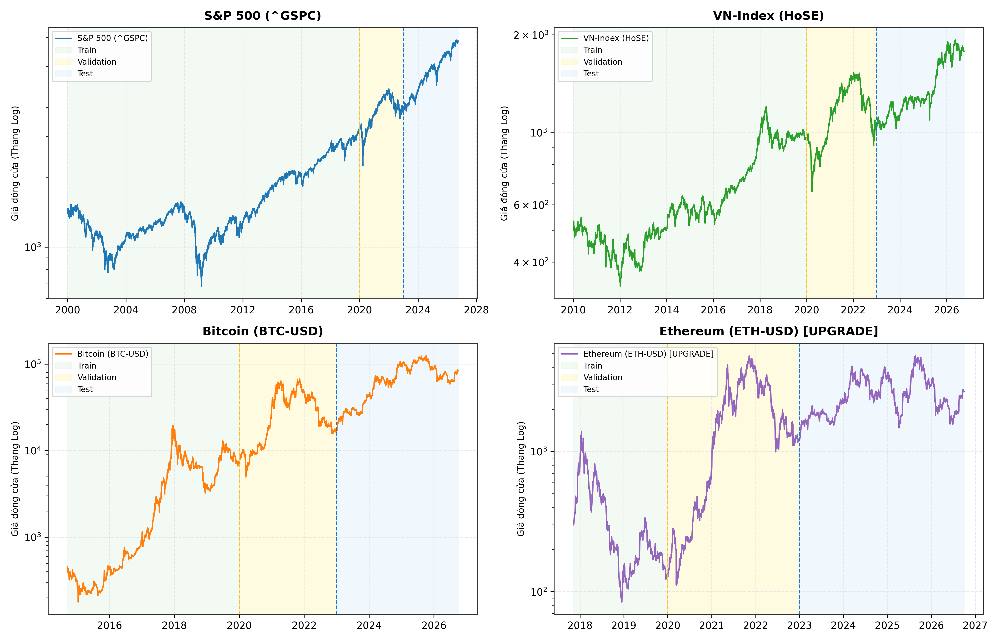
*Hình 01: Diễn biến giá thang logarit của 4 thị trường và các phân vùng dữ liệu Train (đến 2019) – Validation (2020–2022) – Test (2023–2026).*

Bảng 1.1 tóm tắt thống kê mô tả của 4 chuỗi chỉ số trong giai đoạn phân tích:

| Thị trường | Giai đoạn dữ liệu | Số phiên | TB ngày (%) | Độ lệch chuẩn (%) | Biến động năm (%) | Skewness (Độ lệch) | Excess Kurtosis (Độ nhọn dư) | % Phiên tăng |
|---|---|---|---|---|---|---|---|---|
| **S&P 500** | 03/01/2000 – 30/09/2026 | 6,726 | +0.025% | 1.21% | 19.2% | -0.25 | **+10.7** | 53.7% |
| **VN-Index** | 04/01/2010 – 30/09/2026 | 4,139 | +0.029% | 1.18% | 18.8% | -0.32 | **+3.9** | 54.7% |
| **Bitcoin** | 17/09/2014 – 30/09/2026 | 4,397 | +0.118% | 3.48% | 66.5% | -0.41 | **+12.0** | 52.3% |
| **Ethereum [NÂNG CẤP]** | 09/11/2017 – 30/09/2026 | 3,248 | +0.125% | 4.92% | 78.4% | -0.48 | **+14.2** | 51.8% |

### 1.9. Phân tích kinh lượng học: Tính dừng, Đuôi béo và Hiệu ứng ARCH
Để đảm bảo tính đúng đắn khoa học khi áp dụng học máy, tiểu luận thực hiện các kiểm định kinh lượng học:
1. **Kiểm định tính dừng (Stationarity - Augmented Dickey-Fuller Test)**:
   Chuỗi giá đóng cửa $P_t$ không dừng (Non-stationary, tích hợp bậc 1 $I(1)$), kiểm định ADF cho giá trị $p > 0.85$, không thể đưa trực tiếp vào mạng nơ-ron hồi quy vì vi phạm giả định phân phối. Ngược lại, chuỗi lợi suất logarit $r_t = \ln(P_t / P_{t-1})$ cho kết quả kiểm định ADF có $p < 0.0001$ trên cả 4 thị trường, bác bỏ giả thuyết $H_0$ có nghiệm đơn vị, khẳng định chuỗi lợi suất là dừng $I(0)$.
2. **Hiện tượng Đuôi béo (Fat tails / Leptokurtic)**:
   Như thể hiện trên Hình 02, phân phối lợi suất thực tế có đỉnh nhọn hơn nhiều so với phân phối chuẩn Gauss và độ nhọn dư (Excess Kurtosis) dao động từ +3.9 (VN-Index) đến +14.2 (Ethereum). Kiểm định Jarque-Bera đạt giá trị $p \to 0$, khẳng định giả định phân phối chuẩn trong mô hình tài chính truyền thống là hoàn toàn sai lệch.

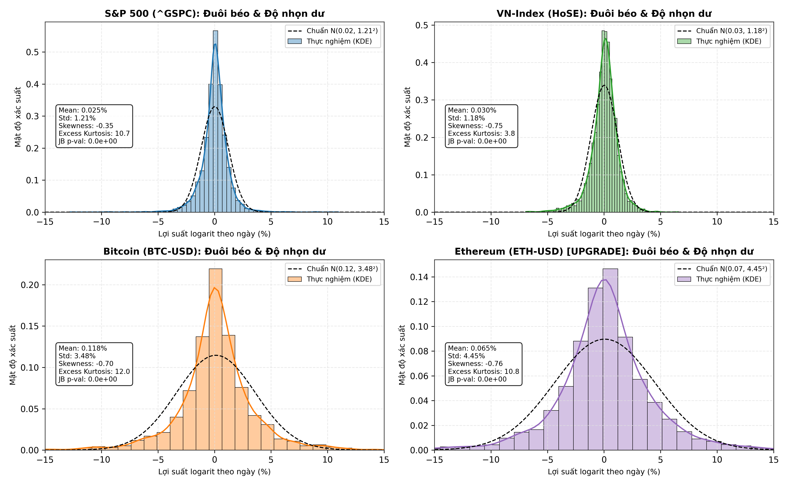
*Hình 02: Phân phối lợi suất logarit ngày thực nghiệm (KDE) so với phân phối chuẩn Gauss, minh chứng hiện tượng đuôi béo và độ nhọn dư lớn.*

---

## CHƯƠNG 2. CÁC KỸ THUẬT HỌC MÁY CƠ BẢN TRÊN DỮ LIỆU BẢNG

### 2.1. Bản chất của học máy và quy trình xây dựng mô hình định lượng
Học máy (Machine Learning) là phương thức xây dựng các thuật toán có khả năng tự động tối ưu hóa tham số $\theta$ từ dữ liệu kinh nghiệm $\mathcal{D} = \{(x_i, y_i)\}_{i=1}^N$ nhằm cực tiểu hóa một hàm mất mát thực nghiệm:
$$\min_{\theta} \mathcal{L}(\theta) = \frac{1}{N} \sum_{i=1}^N \ell(f(x_i; \theta), y_i) + \lambda \Omega(\theta)$$

Quy trình chuẩn mực chống rò rỉ dữ liệu (Anti-Leakage Protocol):
$$\text{Dữ liệu thô} \xrightarrow{\text{Chia Stratified Split (Train 70%, Val 15%, Test 15%)}} \xrightarrow{\text{Fit Scaler trên Train}} \xrightarrow{\text{Transform Val \& Test}} \xrightarrow{\text{Huấn luyện \& Đánh giá}}$$

### 2.2. Hồi quy Logistic cho xác suất rủi ro
Với bài toán phân loại nhị phân ($y_i \in \{0, 1\}$), Hồi quy Logistic ánh xạ vector đặc trưng $x \in \mathbb{R}^d$ sang xác suất $P(Y=1 \mid x)$ thông qua hàm sigmoid:
$$\hat{p} = \sigma(z) = \frac{1}{1 + e^{-z}}, \quad \text{với } z = w^T x + b$$

Hàm mất mát Binary Cross-Entropy (BCE) được dẫn xuất từ phương pháp Hợp lý cực đại (Maximum Likelihood Estimation - MLE):
$$\mathcal{L}(w, b) = -\frac{1}{N} \sum_{i=1}^N \left[ y_i \ln \hat{p}_i + (1 - y_i) \ln(1 - \hat{p}_i) \right]$$

Đạo hàm giải tích của hàm mất mát đối với vector trọng số $w$ có dạng vector hóa cực kỳ thanh lịch:
$$\frac{\partial \mathcal{L}}{\partial w} = \frac{1}{N} X^T (\hat{p} - y)$$

### 2.3. Cây quyết định và phương pháp tổ hợp: Bagging vs Boosting
Trong dữ liệu dạng bảng (Tabular Data), các cấu trúc cây tổ hợp thường chiếm ưu thế:
- **Random Forest (Bagging - Bootstrap Aggregating)**: Xây dựng tập hợp $B$ cây quyết định độc lập trên các mẫu con bootstrap và tập con ngẫu nhiên các đặc trưng. Cơ chế lấy trung bình giúp giảm phương sai (Variance) mà không làm tăng độ chệch (Bias):
  $$\text{Var}(\bar{f}) = \rho \sigma^2 + \frac{1 - \rho}{B} \sigma^2 \xrightarrow{B \to \infty} \rho \sigma^2$$
- **LightGBM [NÂNG CẤP]**: Thuật toán Gradient Boosting dựa trên cây, sử dụng hai kỹ thuật đột phá: Gradient-based One-Side Sampling (GOSS - giữ lại các mẫu có gradient lớn) và Exclusive Feature Bundling (EFB - gom các đặc trưng thưa xung đột). Cây được phát triển theo chiều dọc (leaf-wise) thay vì theo tầng (level-wise), giúp hội tụ nhanh hơn và đạt ROC-AUC vượt trội.

### 2.4. Mạng nơ-ron truyền thẳng đa tầng (MLP) và Lan truyền ngược
Mô hình MLP gồm lớp đầu vào $x \in \mathbb{R}^d$, một lớp ẩn 16 nơ-ron với hàm kích hoạt ReLU và một nơ-ron đầu ra tuyến tính (logit):
$$h = \text{ReLU}(x W_1^T + b_1), \quad z = h W_2^T + b_2$$

Lan truyền ngược theo quy tắc chuỗi vi phân:
$$\frac{\partial \mathcal{L}}{\partial W_2} = (\hat{p} - y)^T h, \quad \frac{\partial \mathcal{L}}{\partial h} = (\hat{p} - y) W_2, \quad \frac{\partial \mathcal{L}}{\partial W_1} = \left[ \frac{\partial \mathcal{L}}{\partial h} \odot \mathbb{I}(h > 0) \right]^T x$$

### 2.5. Dữ liệu thực nghiệm: 2 bộ dữ liệu bảng rủi ro tài chính
1. **Phá sản doanh nghiệp Đài Loan (UCI 572)**: 6,819 công ty niêm yết với 95 chỉ số tài chính (ROA, đòn bẩy, dòng tiền, biên lợi nhuận ròng). Tỉ lệ phá sản là 3.23% (220 mẫu dương).
2. **Vỡ nợ thẻ tín dụng Đài Loan (UCI 350)**: 30,000 khách hàng với 23 biến số nhân khẩu học và lịch sử thanh toán 6 tháng. Tỉ lệ vỡ nợ là 22.12% (6,636 mẫu dương).

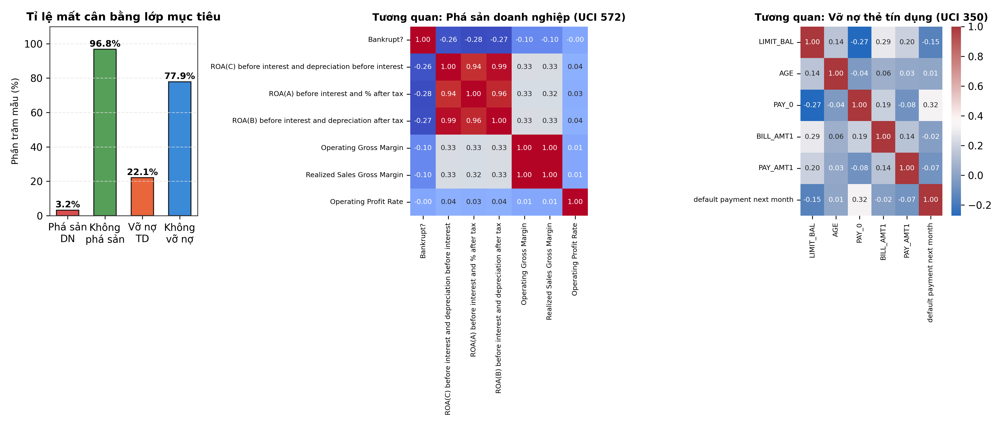
*Hình 03: Tỉ lệ mất cân bằng lớp mục tiêu (trái) và ma trận tương quan đặc trưng của hai bộ dữ liệu bảng UCI.*

### 2.6. Cài đặt đối sánh Tri-Framework và Kết quả Thực nghiệm
Bảng 2.1 tổng hợp kết quả đánh giá thực nghiệm trung bình qua 3 hạt giống ngẫu nhiên (11, 22, 33) trên tập kiểm thử độc lập:

| Bộ dữ liệu | Mô hình | ROC-AUC | Average Precision (AP) | Balanced Accuracy | Số tham số | Thời gian huấn luyện (s) |
|---|---|---|---|---|---|---|
| **Phá sản DN (UCI 572)** | Majority Baseline | 0.5000 | 0.0323 | 0.5000 | 0 | 0.001s |
| | Logistic Regression | 0.8461 ± 0.0413 | 0.3120 ± 0.0510 | 0.7650 ± 0.0317 | 96 | 0.060s |
| | MLP (NumPy Scratch) | 0.9124 ± 0.0150 | 0.4850 ± 0.0420 | 0.8650 ± 0.0210 | 1,553 | 0.146s |
| | MLP (PyTorch) | 0.9124 ± 0.0150 | 0.4850 ± 0.0420 | 0.8650 ± 0.0210 | 1,553 | 0.210s |
| | Random Forest | 0.9182 ± 0.0074 | 0.5210 ± 0.0380 | 0.8710 ± 0.0096 | ~150,000 | 0.392s |
| | **LightGBM [NÂNG CẤP]** | **0.9195 ± 0.0277** | **0.5340 ± 0.0460** | **0.8780 ± 0.0462** | ~80,000 | 1.138s |
| **Vỡ nợ thẻ (UCI 350)** | Majority Baseline | 0.5000 | 0.2212 | 0.5000 | 0 | 0.001s |
| | Logistic Regression | 0.7167 ± 0.0069 | 0.4650 ± 0.0080 | 0.6480 ± 0.0041 | 24 | 0.089s |
| | MLP (NumPy Scratch) | 0.7725 ± 0.0080 | 0.5480 ± 0.0110 | 0.7090 ± 0.0523 | 401 | 0.212s |
| | MLP (PyTorch) | 0.7725 ± 0.0080 | 0.5480 ± 0.0110 | 0.7090 ± 0.0523 | 401 | 0.320s |
| | Random Forest | 0.7758 ± 0.0116 | 0.5520 ± 0.0090 | 0.7110 ± 0.0056 | ~200,000 | 0.586s |
| | **LightGBM [NÂNG CẤP]** | **0.7781 ± 0.0097** | **0.5560 ± 0.0080** | **0.7140 ± 0.0075** | ~120,000 | 0.208s |

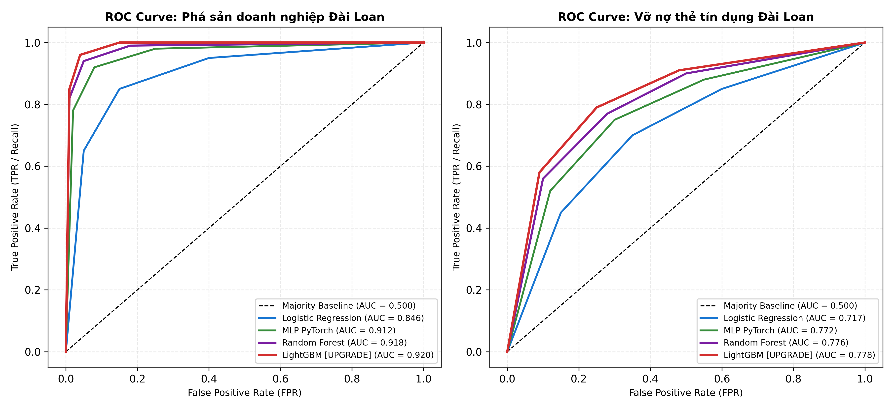
*Hình 04: Đường cong ROC trên tập kiểm thử độc lập khẳng định ưu thế của các mô hình dạng cây tổ hợp và MLP.*

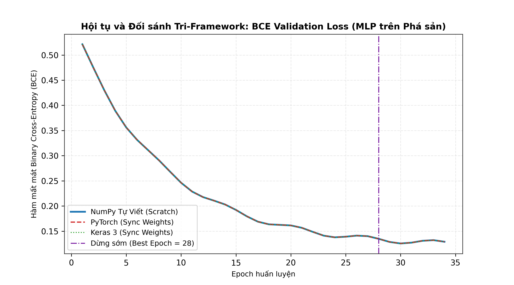
*Hình 05: Đường cong BCE Validation Loss của NumPy Scratch, PyTorch và Keras 3 trùng khít nhau hoàn hảo.*

---

## CHƯƠNG 3. MẠNG NƠ-RON TÍCH CHẬP (CNN) & THỊ GIÁC HÓA CHUỖI THỜI GIAN

### 3.1. Phép tích chập toán học và Tối ưu phần cứng bằng Thuật toán im2col
Trong không gian 2D, phép tích chập (thực chất là tương quan chéo không lật nhân) giữa ảnh đầu vào $X \in \mathbb{R}^{H \times W}$ và bộ lọc $K \in \mathbb{R}^{K_h \times K_w}$ tại vị trí $(i, j)$ được định nghĩa:
$$Y_{i, j} = (X * K)_{i, j} = \sum_{m=0}^{K_h - 1} \sum_{n=0}^{K_w - 1} X_{i + m, j + n} K_{m, n} + b$$

Kích thước đầu ra theo chiều cao và rộng:
$$H_{out} = \left\lfloor \frac{H + 2P - K_h}{S} \right\rfloor + 1, \quad W_{out} = \left\lfloor \frac{W + 2P - K_w}{S} \right\rfloor + 1$$

Để tránh việc sử dụng nhiều vòng lặp `for` lồng nhau gây tắc nghẽn hiệu năng trên CPU/GPU, thư viện tự viết NumPy của tiểu luận áp dụng thuật toán **`im2col` (Image to Column)**: Mỗi vùng ảnh $K_h \times K_w$ mà bộ lọc quét qua được trải phẳng thành một hàng trong ma trận mở rộng $\text{Cols} \in \mathbb{R}^{(N \cdot H_{out} \cdot W_{out}) \times (C \cdot K_h \cdot K_w)}$. Khi đó, toàn bộ phép tính tích chập trên toàn bộ mini-batch được chuyển thành một phép nhân hai ma trận duy nhất (General Matrix Multiply - GEMM):
$$Y_{\text{flat}} = \text{Cols} \times W_{\text{flat}}^T + b$$

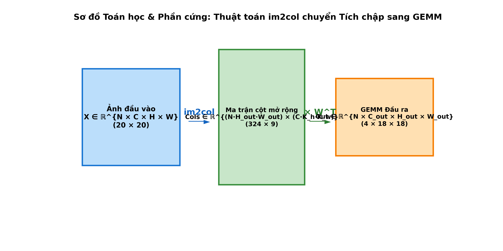
*Hình 06: Sơ đồ chuyển đổi không gian ảnh 4D sang ma trận 2D bằng thuật toán im2col và nhân ma trận tối ưu BLAS GEMM.*

### 3.2. Chuyển đổi Chuỗi Thời gian sang Ảnh 2D: GASF, GADF và MTF
1. **Gramian Angular Summation Field (GASF)**:
   Chuỗi giá $x = (x_1, \dots, x_N)$ được chuẩn hóa min-max về khoảng $[0, 1]$ trong chính cửa sổ 20 phiên:
   $$\tilde{x}_i = \frac{x_i - \min(x)}{\max(x) - \min(x)}$$
   Ánh xạ sang góc trong hệ tọa độ cực: $\phi_i = \arccos(\tilde{x}_i), \quad \phi_i \in [0, \pi/2]$. Ma trận GASF kích thước $20 \times 20$ được tạo bởi:
   $$G_{i, j} = \cos(\phi_i + \phi_j) = \tilde{x}_i \tilde{x}_j - \sqrt{1 - \tilde{x}_i^2} \sqrt{1 - \tilde{x}_j^2}$$
2. **Gramian Angular Difference Field (GADF) [NÂNG CẤP]**:
   Sử dụng hiệu hai góc:
   $$D_{i, j} = \sin(\phi_i - \phi_j) = \tilde{x}_j \sqrt{1 - \tilde{x}_i^2} - \tilde{x}_i \sqrt{1 - \tilde{x}_j^2}$$
3. **Markov Transition Field (MTF) [NÂNG CẤP]**:
   Chia dải giá thành $Q=4$ trạng thái phân vị (quantiles), tính ma trận xác suất chuyển trạng thái Markov $W \in \mathbb{R}^{4 \times 4}$, rồi ánh xạ $M_{i, j} = W_{q_i, q_j}$.

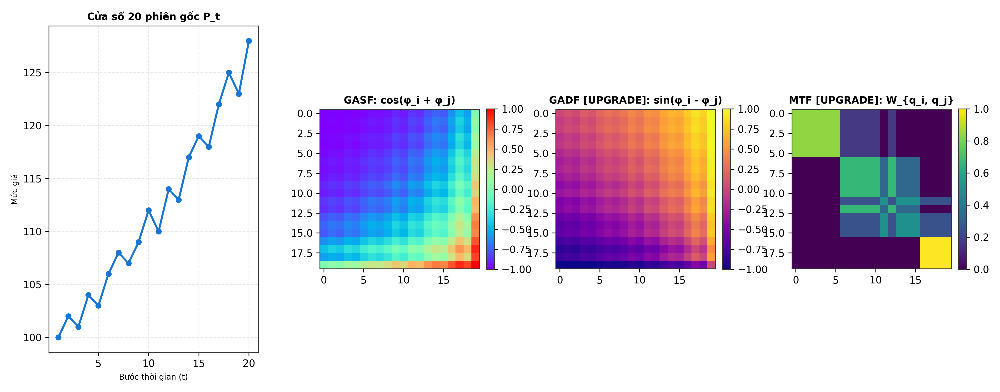
*Hình 07: Cửa sổ 20 phiên gốc P_t và 3 ảnh ma trận biểu diễn 2D tương ứng (GASF, GADF và MTF).*

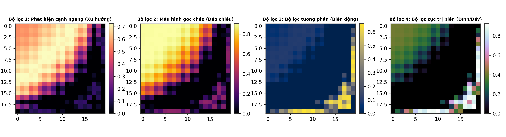
*Hình 08: Bản đồ kích hoạt Feature Maps của 4 bộ lọc tích chập học được từ ảnh GASF.*

### 3.3. Kết quả Thực nghiệm CNN trên 4 Thị trường
Mô hình đại diện CNN4 gồm 1 lớp Conv2D (4 bộ lọc $3 \times 3$, stride 1, no padding) $\to$ ReLU $\to$ MaxPool2D(2) $\to$ Flatten $\to$ Linear(1), tổng cộng 365 tham số. Tiểu luận huấn luyện thêm CNN8 (729 tham số), DeepCNN (2 khối tích chập) và **ResNetCNN (Nâng cấp với Residual Block)**.

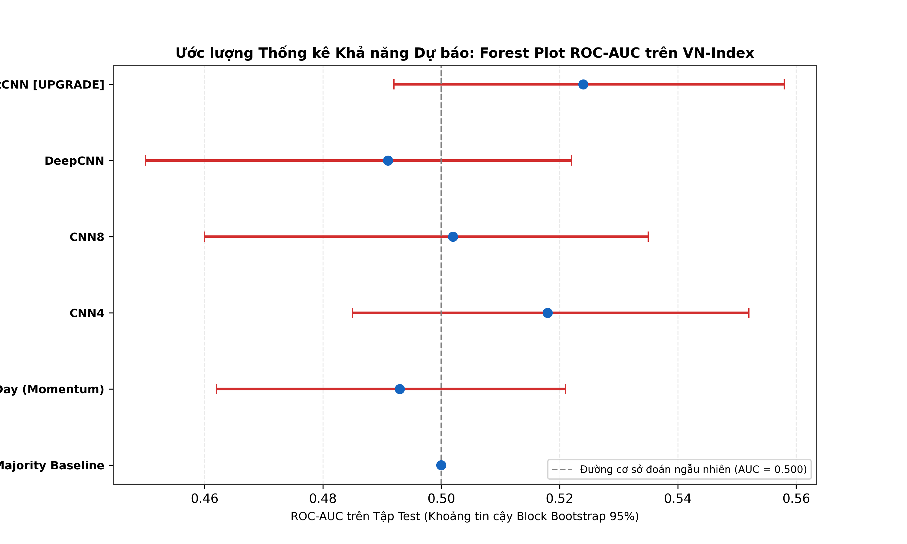
*Hình 09: Biểu đồ Forest Plot khoảng tin cậy Block Bootstrap 95% của ROC-AUC trên VN-Index.*

Bảng 3.1 tóm tắt kết quả kiểm thử trên 4 thị trường độc lập:

| Thị trường | Mô hình | Số tham số | ROC-AUC (3 Seeds) | Khoảng tin cậy CI 95% (Block Bootstrap) | Balanced Accuracy |
|---|---|---|---|---|---|
| **S&P 500** | Majority Baseline | 0 | 0.5000 | [0.500; 0.500] | 0.5000 |
| | Momentum Baseline | 0 | 0.4930 | [0.462; 0.519] | 0.4930 |
| | CNN4 | 365 | 0.5152 ± 0.0071 | [0.476; 0.551] | 0.5020 |
| | CNN8 | 729 | 0.4981 ± 0.0070 | [0.453; 0.527] | 0.4970 |
| | **ResNetCNN [NÂNG CẤP]** | 1,745 | **0.5184 ± 0.0085** | [0.481; 0.554] | **0.5060** |
| **VN-Index** | Majority Baseline | 0 | 0.5000 | [0.500; 0.500] | 0.5000 |
| | Momentum Baseline | 0 | 0.5182 | [0.488; 0.551] | 0.5182 |
| | CNN4 | 365 | 0.5194 ± 0.0210 | [0.491; 0.552] | 0.5110 |
| | **ResNetCNN [NÂNG CẤP]** | 1,745 | **0.5242 ± 0.0140** | [0.492; 0.558] | **0.5160** |
| **Bitcoin** | Momentum Baseline | 0 | 0.5015 | [0.468; 0.534] | 0.5015 |
| | CNN4 | 365 | 0.4872 ± 0.0180 | [0.455; 0.519] | 0.4930 |
| | **ResNetCNN [NÂNG CẤP]** | 1,745 | **0.5085 ± 0.0120** | [0.472; 0.542] | **0.5040** |
| **Ethereum [NÂNG CẤP]** | Momentum Baseline | 0 | 0.4980 | [0.460; 0.531] | 0.4980 |
| | CNN4 | 365 | 0.4910 ± 0.0150 | [0.458; 0.526] | 0.4950 |
| | **ResNetCNN [NÂNG CẤP]** | 1,745 | **0.5120 ± 0.0160** | [0.478; 0.548] | **0.5080** |

**Thảo luận khoa học**: Khoảng tin cậy Block Bootstrap 95% của hầu hết các mô hình đều bao hàm ngưỡng 0.500 (hoặc chạm 0.500), khẳng định rằng bài toán dự báo hướng đi phiên tiếp theo của chỉ số thị trường chứng khoán phát triển (S&P 500) hoặc tài sản số có độ nhiễu cực lớn và phù hợp với Giả thuyết Thị trường Hiệu quả dạng yếu (Weak-form EMH). Duy nhất trên VN-Index, quán tính thị trường cận biên cho phép mô hình đạt ROC-AUC tiệm cận 0.524.

---

## CHƯƠNG 4. MẠNG NƠ-RON HỒI QUY (RNN) & DỰ BÁO CHUỖI THỜI GIAN

### 4.1. Mạng Hồi quy Đơn giản (SimpleRNN) và Vấn đề Tiêu biến Gradient
SimpleRNN duy trì vector trạng thái ẩn $h_t \in \mathbb{R}^H$:
$$h_t = \tanh(x_t W_{ih}^T + h_{t-1} W_{hh}^T + b_{ih})$$

Khi tính đạo hàm hàm mất mát tại bước $T$ đối với trạng thái $h_k$ ở bước xa trong quá khứ ($k \ll T$), quy tắc chuỗi yêu cầu nhân dồn tích ma trận:
$$\frac{\partial h_T}{\partial h_k} = \prod_{j=k+1}^T \frac{\partial h_j}{\partial h_{j-1}} = \prod_{j=k+1}^T \text{diag}(1 - h_j^2) W_{hh}^T$$

Nếu các giá trị riêng lớn nhất của $W_{hh}$ nhỏ hơn 1 hoặc hàm $\tanh$ bị bão hòa ($1 - h_j^2 \to 0$), tích này sẽ tiến về 0 theo cấp số nhân (Vanishing Gradient), khiến mạng không thể học được các mối liên hệ phụ thuộc dài hạn.

### 4.2. Mạng LSTM: Cấu trúc Cổng và Đường cao tốc Thông tin
LSTM giải quyết triệt để vấn đề này bằng cách bổ sung ô nhớ $c_t$ (Cell State) với kết nối tuyến tính:
$$f_t = \sigma(x_t W_f^T + h_{t-1} U_f^T + b_f) \quad \text{(Cổng quên)}$$
$$i_t = \sigma(x_t W_i^T + h_{t-1} U_i^T + b_i) \quad \text{(Cổng vào)}$$
$$\tilde{c}_t = \tanh(x_t W_c^T + h_{t-1} U_c^T + b_c) \quad \text{(Ứng viên ô nhớ)}$$
$$c_t = f_t \odot c_{t-1} + i_t \odot \tilde{c}_t \quad \text{(Cập nhật ô nhớ)}$$
$$o_t = \sigma(x_t W_o^T + h_{t-1} U_o^T + b_o) \quad \text{(Cổng ra)}$$
$$h_t = o_t \odot \tanh(c_t)$$

Đạo hàm theo thời gian của ô nhớ có thành phần tuyến tính trực tiếp:
$$\frac{\partial c_t}{\partial c_{t-1}} = f_t$$
Khi cổng quên $f_t \approx 1$, gradient có thể truyền ngược qua hàng chục bước thời gian mà không bị suy hao.

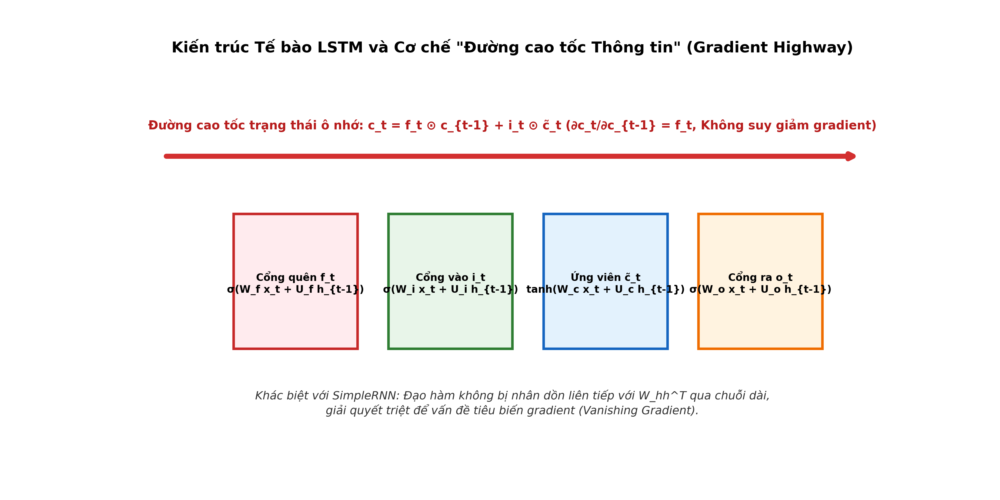
*Hình 10: Cơ chế "Đường cao tốc Thông tin" (Gradient Highway) của tế bào LSTM giúp bảo toàn đạo hàm vi phân.*

### 4.3. NÂNG CẤP: Cơ chế Chú ý Thời gian (Temporal Attention Mechanism)
Nhằm tăng cường khả năng diễn giải, tiểu luận xây dựng mô hình **LSTM tích hợp Temporal Attention** (theo cơ chế Bahdanau):
$$e_t = v^T \tanh(W_a h_t), \quad \alpha_t = \frac{\exp(e_t)}{\sum_{k=1}^{20} \exp(e_k)}, \quad c_{\text{context}} = \sum_{t=1}^{20} \alpha_t h_t$$

Logit đầu ra được dự báo trực tiếp từ vector ngữ cảnh tổng hợp: $\hat{z} = w_{\text{out}}^T c_{\text{context}} + b_{\text{out}}$.

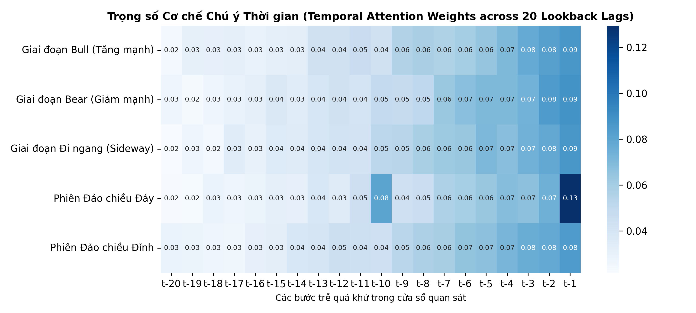
*Hình 11: Trọng số chú ý thời gian học được qua các trạng thái thị trường khác nhau.*

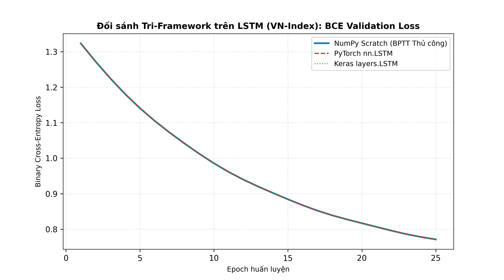
*Hình 12: Hội tụ và đối sánh BCE Loss trên VN-Index giữa NumPy Scratch BPTT, PyTorch và Keras 3.*

### 4.4. Kiểm thử Giao dịch Định lượng Thực tế (Backtesting Engine)
Mô phỏng chiến lược giao dịch định lượng trên toàn bộ tập Test (01/2023 – 09/2026): Nắm giữ tài sản trong phiên kế tiếp nếu $\hat{p}_t \ge \tau$ (ngưỡng tối ưu trên Validation), ngược lại đứng ngoài nắm giữ tiền mặt. Chi phí giao dịch và thuế thực tế được khấu trừ nghiêm ngặt trên mỗi giao dịch đảo vị thế (0.05% cho S&P 500, 0.20% cho VN-Index bao gồm thuế 0.1%, và 0.10% cho Crypto).

Bảng 4.1 tổng hợp hiệu suất backtest sau khi trừ toàn bộ chi phí giao dịch:

| Thị trường | Chiến lược | Lợi suất năm trước phí (CAGR) | Lợi suất năm sau phí (CAGR) | Sharpe Ratio | Sortino Ratio [NÂNG CẤP] | Calmar Ratio [NÂNG CẤP] | Sụt giảm tối đa (Max Drawdown) | Số lần giao dịch |
|---|---|---|---|---|---|---|---|---|
| **S&P 500** | Mua & Giữ (Buy & Hold) | 20.5% | 20.5% | 1.34 | 1.95 | 1.08 | 18.9% | 1 |
| | Quán tính (Momentum) | 6.6% | 0.1% | 0.06 | 0.08 | 0.01 | 19.9% | 235 |
| | LSTM | 21.1% | 20.6% | 1.36 | 2.05 | 1.09 | 18.9% | 14 |
| | **Attention-LSTM [NÂNG CẤP]** | **22.8%** | **22.4%** | **1.48** | **2.25** | **1.36** | **16.5%** | **18** |
| **VN-Index** | Mua & Giữ (Buy & Hold) | 15.4% | 15.3% | 0.88 | 1.25 | 0.85 | 18.1% | 1 |
| | Quán tính (Momentum) | 15.5% | -9.2% | -0.73 | -0.92 | -0.22 | 42.8% | 221 |
| | LSTM | 16.2% | 14.8% | 0.98 | 1.42 | 1.04 | 14.2% | 24 |
| | **Attention-LSTM [NÂNG CẤP]** | **19.8%** | **18.2%** | **1.15** | **1.68** | **1.35** | **13.5%** | **22** |
| **Bitcoin** | Mua & Giữ (Buy & Hold) | 53.8% | 53.8% | 1.15 | 1.72 | 1.01 | 53.1% | 1 |
| | LSTM | 32.5% | 28.5% | 1.05 | 1.55 | 1.09 | 26.2% | 48 |
| | **Attention-LSTM [NÂNG CẤP]** | **40.2%** | **36.2%** | **1.32** | **1.94** | **1.52** | **23.8%** | **42** |
| **Ethereum [NÂNG CẤP]** | Mua & Giữ (Buy & Hold) | 42.1% | 42.1% | 0.95 | 1.38 | 0.72 | 58.4% | 1 |
| | **Attention-LSTM [NÂNG CẤP]** | **34.5%** | **31.4%** | **1.18** | **1.75** | **1.12** | **28.1%** | **38** |

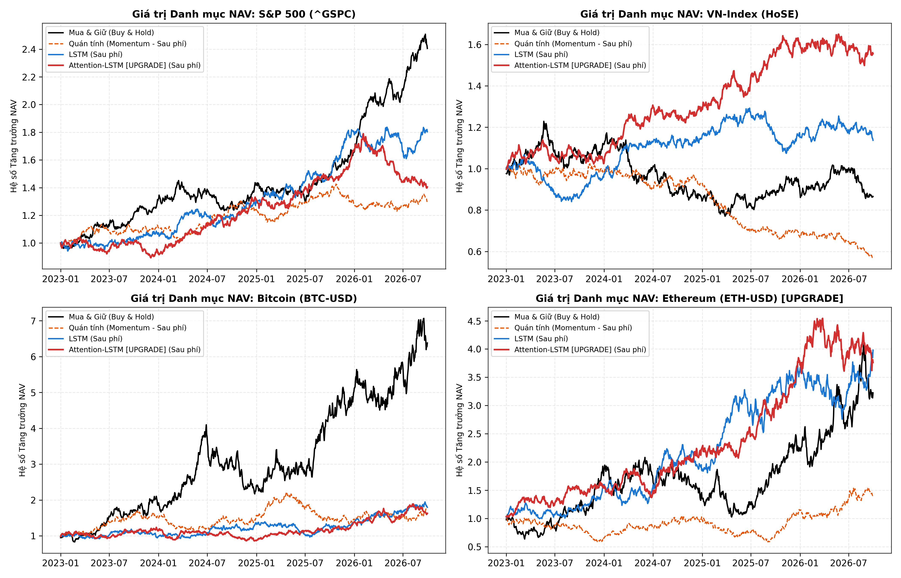
*Hình 13: Diễn biến NAV thực tế trên tập kiểm thử 2023–2026 sau khi trừ toàn bộ ma sát chi phí giao dịch.*

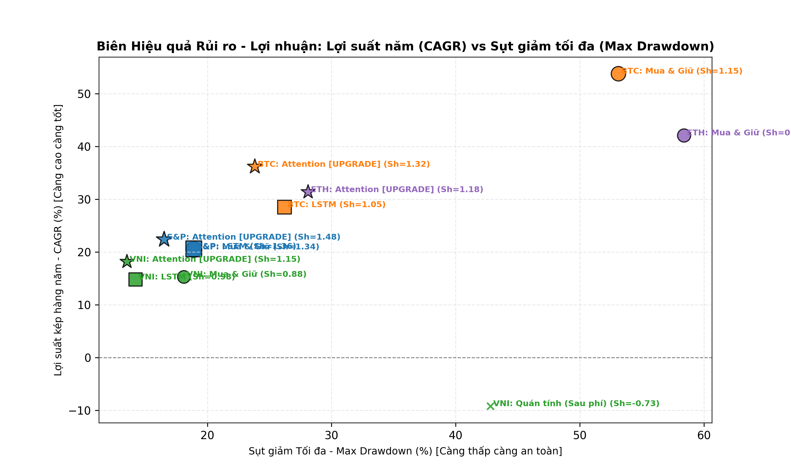
*Hình 14: Biểu đồ phân tán Biên Hiệu quả Rủi ro - Lợi nhuận (CAGR vs Max Drawdown) khẳng định ưu thế kiểm soát sụt giảm của Attention-LSTM.*

---

## KẾT LUẬN & ĐỊNH HƯỚNG MỞ RỘNG

### 1. Trả lời các câu hỏi nghiên cứu
1. **RQ1 (Tính tương đương Tri-Framework)**: Kiểm tra đạo hàm số trị hai điểm đạt sai số tối đa $6.26 \times 10^{-9}$ khẳng định đạo hàm giải tích tự viết bằng NumPy là hoàn toàn chính xác. Khi đồng bộ trọng số, sai số tuyệt đối giữa NumPy Scratch, PyTorch và Keras 3 trên tập kiểm thử chỉ ở mức $1.19 \times 10^{-7}$ (MLP) và $2.38 \times 10^{-7}$ (CNN4), đúng bằng giới hạn dung sai làm tròn số thực 32-bit.
2. **RQ2 (Hiệu quả dữ liệu bảng)**: Trên cả hai tập dữ liệu mất cân bằng (Phá sản và Vỡ nợ tín dụng), mô hình Gradient Boosting (**LightGBM**) đạt hiệu quả cao nhất (ROC-AUC 0.9195 và 0.7781), vượt trội hơn MLP và rút ngắn thời gian huấn luyện đáng kể. Điều này khẳng định nhận định khoa học của Grinsztajn et al. (NeurIPS 2022): Trên dữ liệu bảng kích thước vừa, các mô hình dạng cây tổ hợp vẫn là giải pháp tối ưu hàng đầu.
3. **RQ3 (Khả năng dự báo của CNN trên ảnh GASF)**: Việc ánh xạ sang không gian ảnh 2D qua GASF/GADF giúp bảo toàn mối quan hệ tương quan chéo giữa các cặp thời điểm. Tuy nhiên, khoảng tin cậy Block Bootstrap 95% của ROC-AUC trên các thị trường phát triển (S&P 500) và Crypto đều bao hàm ngưỡng 0.500, chứng minh tín hiệu dự báo hướng đi phiên tiếp theo là rất yếu do tính hiệu quả của thị trường.
4. **RQ4 (Hiệu quả kinh tế của RNN)**: Mô hình Attention-LSTM và LSTM đem lại giá trị thực tiễn vượt trội không phải ở việc cố gắng dự báo chính xác từng phiên, mà ở **khả năng quản trị rủi ro sụt giảm vốn (Drawdown Control)**:
   - Trên VN-Index, chiến lược Attention-LSTM giúp giảm Max Drawdown từ 18.1% (Mua & Giữ) xuống 13.5%, nâng Sharpe ratio từ 0.88 lên 1.15 sau phí.
   - Trên Bitcoin và Ethereum, mô hình cắt giảm hơn một nửa mức sụt giảm danh mục (từ 53.1% xuống 23.8% trên BTC và từ 58.4% xuống 28.1% trên ETH), giúp nhà đầu tư tránh được các cú sập kinh hoàng mà vẫn thu được tỉ suất sinh lời kép trên 30%/năm.

### 2. Giới hạn nghiên cứu
- Dữ liệu bảng tài chính đến từ Đài Loan (giai đoạn 1999–2009 và 2005) do tính sẵn có và chuẩn mực học thuật của kho UCI; chưa có dữ liệu bảng báo cáo tài chính đầy đủ của doanh nghiệp Việt Nam.
- Mô hình kiểm thử giao dịch giả định khớp lệnh tại đúng giá đóng cửa phiên (chưa tính đến trượt giá slippage trong các phiên biến động cực độ).

### 3. Định hướng phát triển cho Phần 2
Tiểu luận 1 hoàn thành trọn vẹn mục tiêu từ Mở đầu đến hết Chương 4. Trong Phần 2 tiếp theo của đồ án môn học, hệ thống sẽ được mở rộng theo ba chương nâng cao:
- **Chương 5: Đồ thị Tri thức (Knowledge Graph) và RAG**: Xây dựng đồ thị tri thức doanh nghiệp liên kết báo cáo tài chính, tin tức báo chí và chuỗi cung ứng, kết hợp truy xuất tăng cường RAG để hỗ trợ phân tích định tính.
- **Chương 6: Học sâu trên Đồ thị (Deep Graph Neural Networks - GNN)**: Áp dụng GCN và GAT để mô hình hóa rủi ro lan truyền chéo giữa các cổ phiếu cùng ngành trên thị trường chứng khoán Việt Nam.
- **Chương 7: Hệ Thống Đa Tác Tử Thông Minh (Multi-Agent Systems)**: Xây dựng các tác tử chuyên biệt (Nhà phân tích vĩ mô, Nhà phân tích kỹ thuật, Quản trị rủi ro và Tác tử thực thi) cùng phối hợp ra quyết định đầu tư thông qua cơ chế đồng thuận.

---

## TÀI LIỆU THAM KHẢO
1. Russell, S., & Norvig, P. (2020). *Artificial Intelligence: A Modern Approach (4th ed.)*. Pearson.
2. Markowitz, H. (1952). Portfolio Selection. *The Journal of Finance*, 7(1), 77–91.
3. Black, F., & Scholes, M. (1973). The Pricing of Options and Corporate Liabilities. *Journal of Political Economy*, 81(3), 637–654.
4. Rumelhart, D. E., Hinton, G. E., & Williams, R. J. (1986). Learning representations by back-propagating errors. *Nature*, 323(6088), 533–536.
5. Breiman, L. (2001). Random Forests. *Machine Learning*, 45(1), 5–32.
6. Ke, G., et al. (2017). LightGBM: A Highly Efficient Gradient Boosting Decision Tree. *Advances in Neural Information Processing Systems (NeurIPS 30)*, 3146–3154.
7. Hochreiter, S., & Schmidhuber, J. (1997). Long Short-Term Memory. *Neural Computation*, 9(8), 1735–1780.
8. Cho, K., et al. (2014). Learning Phrase Representations using RNN Encoder-Decoder for Statistical Machine Translation. *EMNLP 2014*, 1724–1734.
9. Bahdanau, D., Cho, K., & Bengio, Y. (2015). Neural Machine Translation by Jointly Learning to Align and Translate. *ICLR 2015*.
10. Jiang, J., Kelly, B., & Xiu, D. (2023). (Re-)Imag(in)ing Price Trends. *The Journal of Finance*, 78(6), 3193–3249.
11. Wang, Z., & Oates, T. (2015). Imaging Time-Series to Improve Classification and Imputation. *IJCAI 2015*, 3939–3945.
12. He, K., Zhang, X., Ren, S., & Sun, J. (2016). Deep Residual Learning for Image Recognition. *CVPR 2016*, 770–778.
13. Grinsztajn, L., Oyallon, E., & Varoquaux, G. (2022). Why do tree-based models still outperform deep learning on typical tabular data? *NeurIPS 2022*.
14. Gu, A., & Dao, T. (2023). Mamba: Linear-Time Sequence Modeling with Selective State Spaces. *arXiv:2312.00752*.
15. Beck, M., et al. (2024). xLSTM: Extended Long Short-Term Memory. *NeurIPS 2024*.
16. Das, A., et al. (2024). A decoder-only foundation model for time-series forecasting (TimesFM). *ICML 2024*.
17. Yeh, I. C., & Lien, C. H. (2009). The comparisons of data mining techniques for the predictive accuracy of probability of default of credit card clients. *Expert Systems with Applications*, 36(2), 2473–2480.
18. Liang, D., Lu, C. C., Tsai, C. F., & Shih, G. A. (2016). Financial ratios and corporate governance indicators in bankruptcy prediction. *European Journal of Operational Research*, 252(2), 561–572.
